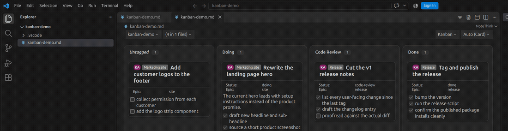
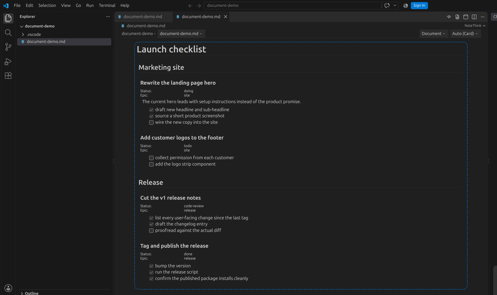
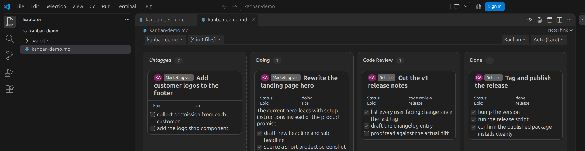
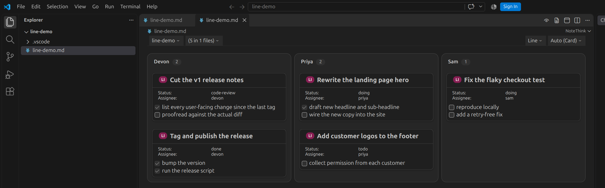

# NoteThink

Your `todo.md` is already a project board. NoteThink renders any markdown file - a plain checklist, a full `todo.md` / `done.md` pair, a whole folder of them - as a live Kanban board, a single-group Line view, or a structured Document view, right inside VS Code. Nothing to sign up for, nothing to sync: it reads the markdown you already have, live. Drag a card or tick a checkbox and NoteThink writes exactly that change back to the file - nothing else changes unless you drag or tick something yourself; it is not a free-text editor.



> **Status:** Preview / Beta - this is an early release. Expect rough edges.

## Install

- In VS Code, open the Extensions view (`Ctrl+Shift+X`), search for **NoteThink**, and click **Install**, or
- From the command line: `code --install-extension NoteThink.notethink`

Then open any `.md` file, right-click it and choose **Open With... -> NoteThink**.

## Features

- **Kanban and Line boards**: group stories by status, assignee, or any attribute you author - drag a card to rewrite its status (or grouping attribute) linetag in the file
- **Group order**: drag the groups into your own order, or let the board order them by when their cards last changed (in either direction), alphabetically, or by card count
- **Document view**: the same file read top to bottom, nested and structured
- **Folder mode**: aggregate every markdown file in a folder into one board
- **Live Updates**: edit the file in the normal text editor and the view updates in place, debounced
- **Agent activity**: see which AI coding agents (Claude Code, Codex, Grok, and any other vendor registered with thinkersync) are working on which story, live, on desktop - including a remote window, where it reads the sessions on the host serving the workspace
- **Linetags**: plain markdown links carry status, epic, and other attributes invisibly - see [AUTHORING_GUIDE.md](./AUTHORING_GUIDE.md)
- **GFM + Frontmatter**: tables, strikethrough, task lists, footnotes, YAML/TOML frontmatter
- **Coordinators beside boards**: on desktop, a folder view lists the agents registered with thinkersync beside the boards they own, with a send-to-agent message and a draggable target line - see [Coordinators beside boards](#coordinators-beside-boards)
- **Writes back a few things, precisely**: a card drag, a checkbox click, and, on your own action, a message to an agent and its target line - see [Known Limitations](#known-limitations)

## Screenshots

| Document | Kanban | Line |
|---|---|---|
|  |  |  |

## Telemetry

NoteThink sends no telemetry. Nothing about how you use the extension leaves your machine.

## Full installation and setup

### From a .vsix (no Marketplace)

```bash
pnpm run package:vsix
code --install-extension notethink-<version>.vsix
```

### Opening a file

1. Open any markdown file (`.md`)
2. Use the command palette (`Ctrl+Shift+P`) and run "NoteThink: Open Viewer"
3. Or right-click on a markdown file and select "Open With..." → "NoteThink"

For the conventions your markdown should follow - heading levels, story structure, linetag syntax, epics, Folder mode - see [AUTHORING_GUIDE.md](./AUTHORING_GUIDE.md).

## Development

### Prerequisites

- [Node.js](https://nodejs.org/) 20+
- [pnpm](https://pnpm.io/) 9+
- [VS Code](https://code.visualstudio.com/)

### Setup

```bash
git clone https://github.com/ZoomBuzz/NoteThink.git
cd NoteThink
pnpm install
```

`postinstall` runs automatically and installs dependencies in the `client/extension`, `client/webview`, and `client/webview/src/notethink-views` sub-packages.

### Dev workflow

1. Open the repo in VS Code: `code .`
2. Press `F5` (or **Run > Start Debugging**). This launches "Run Web Extension" which:
   - Runs `pnpm run watch` (webpack in watch mode) as a pre-launch task
   - Opens a new Extension Development Host window
3. In the dev host, open any `.md` file and right-click → "Open With..." → "NoteThink"
4. Edit the markdown in the standard editor - the NoteThink view updates live (250ms debounce)
5. Code changes in `client/extension/src/` or `client/webview/src/` are recompiled automatically by webpack watch. Reload the dev host window (`Ctrl+R`) to pick them up.

### Inspecting the webview

The NoteThink view runs in a webview iframe. To inspect it:

- In the dev host: **Help > Toggle Developer Tools** (`Shift+Ctrl+I`)
- Enable debug logging in the console: `localStorage.debug = 'nodejs:*'`

For a fuller walkthrough - where host vs webview logs land, how the dev-only `notethink-extension.log` file works, and what to capture when filing a bug - see [docstech/bug-reports.md](docstech/bug-reports.md).

### Commands

| Command | Description |
|---------|-------------|
| `pnpm install` | Install all dependencies (root + sub-packages) |
| `pnpm run compile` | One-shot webpack build |
| `pnpm run watch` | Webpack watch mode (used by F5 launch) |
| `pnpm run package` | Production build (minified, hidden source maps) |
| `pnpm run lint` | ESLint |
| `pnpm test` | Run all unit tests (webview + notethink-views) |
| `pnpm run chrome` | Launch in browser via vscode-test-web (Chromium) |
| `pnpm run package:vsix` | Build a .vsix for local install |

### Testing

**Unit tests** (Jest):

```bash
pnpm test                        # all tests (35)
cd client/webview && pnpm test   # webview tests (14)
cd client/webview/src/notethink-views && pnpm test  # component library tests (21)
```

**Manual extension testing**: Press `F5`, then in the dev host:

- Open a `.md` file → right-click → "Open With..." → NoteThink
- Run "NoteThink: Open Viewer" from the command palette
- Check that headings, code blocks, lists, and task lists render
- Edit the file and verify the view updates
- Open Toggle Developer Tools and check for console errors

**Browser testing**: `pnpm run chrome` launches the extension in Chromium via vscode-test-web, opening the `docstech/` folder as a workspace.

### Building a .vsix

```bash
pnpm run package:vsix
```

This runs the production build (`vscode:prepublish`) then packages into `notethink-<version>.vsix`. Install locally with:

```bash
code --install-extension notethink-<version>.vsix
```

## Project Structure

```
notethink/
├── client/
│   ├── extension/           # VS Code extension (runs in webworker)
│   │   ├── src/
│   │   │   ├── extension.ts # entry point
│   │   │   ├── vscode/      # notethinkEditor, custom editor provider
│   │   │   └── lib/         # parseops, crypto, utils, errorops
│   │   └── dist/            # compiled output (gitignored)
│   │
│   └── webview/             # React webview (renders in iframe)
│       ├── src/
│       │   ├── components/  # ExtensionReceiver, NoteRenderer, App
│       │   └── notethink-views/  # component library (DocumentView, GenericNote, etc.)
│       └── dist/            # bundled webview (gitignored)
│
├── .github/workflows/ci.yml # CI: lint, test (webview + notethink-views)
├── webpack.config.js        # two configs: extension + webview
└── eslint.config.mjs
```

## Architecture

```
┌─────────────────────────────────────────────────────────────┐
│                        VS Code                              │
│  ┌───────────────────┐    ┌─────────────────────────────┐   │
│  │    Extension      │    │        Webview              │   │
│  │  (webworker)      │    │      (iframe)               │   │
│  │                   │    │                             │   │
│  │  ┌─────────────┐  │    │  ┌───────────────────────┐  │   │
│  │  │ notethink   │──┼────┼──│  ExtensionReceiver    │  │   │
│  │  │ Editor.ts   │  │    │  │  (hash-based delta)   │  │   │
│  │  └─────────────┘  │    │  └───────────┬───────────┘  │   │
│  │         │         │    │              │              │   │
│  │         ▼         │    │              ▼              │   │
│  │  ┌─────────────┐  │    │  ┌───────────────────────┐  │   │
│  │  │  parseops   │  │    │  │    NoteRenderer       │  │   │
│  │  │  crypto     │  │    │  │                       │  │   │
│  │  └─────────────┘  │    │  └───────────┬───────────┘  │   │
│  │                   │    │              │              │   │
│  └───────────────────┘    │              ▼              │   │
│                           │  ┌───────────────────────┐  │   │
│                           │  │   notethink-views     │  │   │
│                           │  │   (React.memo'd)      │  │   │
│                           │  └───────────────────────┘  │   │
│                           └─────────────────────────────┘   │
└─────────────────────────────────────────────────────────────┘
```

**Data flow:**
1. Extension finds all `*.md` files, parses each to MDAST, computes SHA-256 hash
2. Docs sent to webview via `postMessage`
3. `ExtensionReceiver` compares hashes - unchanged docs are skipped
4. `NoteRenderer` converts MDAST to NoteProps hierarchy via `convertMdastToNoteHierarchy`
5. `DocumentView` and `GenericNote` (both `React.memo`'d) render the note tree

## Agent activity

The `agent` card type shows which AI coding agents are working on a story, live, by reading each vendor's own session files directly on disk - desktop only (a browser host has no file access to them), and only while a panel is drawing an `agent` card. In a remote window (Remote-SSH and similar), it reads the sessions on the host serving the workspace rather than the desktop running VS Code. NoteThink reads no network endpoint for this and no vendor is asked to write anything for NoteThink to find. The files read, when present:

- **Claude Code**: `~/.claude/sessions/*.json` (which sessions are live, and whether each is working, idle or waiting on you) and `~/.claude/projects/*/*.jsonl` (each session's transcript, including its `subagents/` directory)
- **Codex**: `~/.codex/sessions/YYYY/MM/DD/*.jsonl` (each session's rollout transcript)
- **Grok**: `~/.grok/active_sessions.json` (which sessions are live), `~/.grok/sessions/*/*/events.jsonl` (each session's tool and permission timeline) and the matching `usage.json` where one exists

Transcripts from the last 30 days are read; a vendor with none of the files above present is simply never read from. What has been read is kept in the extension's global storage, one store per agent home, so a window restart re-reads only the sessions whose files changed. A card whose repository's sessions have all been read says what it holds without waiting for the rest of the first scan, and a card with no sessions yet shows that scan's progress. A transcript larger than 64 MB is read from its newest end, the last 64 MB starting at a whole line, and its row says "newest part only" beside its clock, since its usage and time then cover only that part. The card also reads the working tree of every git repository open in the workspace, through VS Code's built-in git extension, to show one collapsed row of uncommitted files with their added and removed line counts, which opens to the full list, and a row counting the local commits not yet pushed (grey when there are none or the branch has no upstream). With commits waiting, that row opens like the files row, showing the line totals across them and, unfolded, each commit's short hash and file count; it lists at most the newest 20 and says so when the branch is further ahead, and a repository whose recent git objects are packed shows the count alone. With nothing uncommitted and nothing to push, the two rows fold into one grey line, `No uncommitted files or pending commits` (`No uncommitted files, no upstream` when the branch has no upstream). It also reads the commits each session made, though the card does not draw them. The card's status line carries the agent count and the combined tokens and approximate cost, such as `2 ag, 8.2Mt, ~$12.40`.

A session appears on a story's card when one of its own file edits changed that story's section of a story board, `docstech/users/<name>/todo.md` or `done.md`, in the workspace folder or in any project directly inside it. A story is matched by its `[](?id=...)` linetag, or by the id derived from its title when it has none, so a story keeps its agents when it moves from `todo.md` to `done.md`. A session that edited no story is drawn on a card of its own rather than guessed onto one, and only beside documents from the same git repository as the session, so a workspace holding several repositories does not draw every repository's agents on every board.

That card is headed by the vendor's mark and the session's name, such as `CC my-session`, in the vendor's colour: the name Claude Code gives a live session, else a short session id. Codex and Grok record no session name, so their cards show the short id.

A Claude Code session that launched subagents, such as a coordinator running several tasks at once, draws them as a tree, laid out like a VS Code tree. The session's row names the session beside its mark and model and shows what it is doing now, such as the shell command it is running; clicking that row opens the session. A chevron beside it expands and collapses the subagents, and the Right and Left arrow keys do the same. The row is expanded while the agent is working or waiting and collapsed otherwise, and a choice you make is kept as the card updates. The agent's state-coloured rail runs down the whole expanded group, so its subagents sit visibly inside it. Each running subagent sits indented under it on its own rail, coloured by that subagent's state, with its mark, model, state, how long it has run, its title (the description its parent gave it, which usually names the work) and the tokens it has used. Finished subagents stay out of the way behind one "Show N finished subagents" item that you can click, or reach from the keyboard, to show them dimmed. A card keeps every running subagent and the latest six finished ones, and the session's own totals still include them all. Codex and Grok record no subagents, so their rows stay flat.

### The agent registry

Agents of any vendor can also be read from the thinkersync agent registry: one `registry/<agent>/agent.json` per agent under `~/.local/share/thinkersync/`, naming the agent, its vendor, its repository, its state and the story it is on. NoteThink reads those files, read-only, on the same machine the agent sessions are read from, for agents whose repository sits inside the open folder. It never writes to the registry or to an agent's mailbox and changes nothing about how an agent runs. A missing, oversize or malformed file is simply ignored, and this too is local files only, with no network endpoint. It shows only the agent's name, vendor, state and story, never its mailbox, terminal pane or program version.

- **A registered agent that also has a session NoteThink can read** (matched by its session id or any earlier one) keeps that session's own state and takes the registry's agent name, such as `coord-demo`, when the vendor named the session nothing.
- **A registered agent with no readable session**, such as one from a vendor NoteThink has no reader for, draws as a flat row with its name, vendor mark, state and story. It has no transcript to open. An idle one sits on a card of its own, as an unbound session does; a `stopped` one is not drawn. A state the registry names that NoteThink does not know is drawn as "State not reported" rather than dropped.
- **A working agent is placed on its story** before it has written anything, so a coordinator shows on its story's card from the moment it starts. The registry's `state` is only a hint, because it changes only when the agent changes state or restarts, so the story must be at `doing`, `code-review` or `testing` on the board for the agent to be placed on it.
- **A `working` entry that nothing backs up reads "Stale"**: its last update is more than two hours old, and neither the story's progress entry nor the agent's own transcript shows any work since.

Clicking an agent on a card opens that session in VS Code: in Claude Code's own chat panel, or, for a vendor with no such panel, as the session's transcript in an editor.

### Coordinators beside boards

A folder view lists the registered coordinators beside its boards, read from the same registry. A coordinator is the long-lived agent that owns one repository's board. The panel appears above the board in folder view whenever a story board (`docstech/users/<name>/todo.md`) is loaded, and has one row for every registered coordinator whose repository holds a loaded file: a folder holding several repositories lists each repository's agent, and a view open on one repository, or a folder inside it, lists the one agent that owns it. It is desktop only, like the `agent` card, because a browser host has no file access to the registry, and in a remote window it reads the registry on the host serving the workspace. A repository with no registered coordinator shows none.

NoteThink only shows and asks: it never starts, stops or restarts an agent. Each row shows the agent's name, its state (working, idle, starting, recycling or stopped), the story it is on, its program version and how many convoys it has open, as the registry records them. Two buttons open under a row:

- **Send to agent** opens a message box. Pressing **Send** writes one envelope, a small JSON file, into the agent's mailbox on that machine (`mailboxes/<agent>/inbox/` beside the registry). The file is written under a temporary name and renamed into place, so the agent never reads half of it. Nothing is ever sent automatically, and an agent whose mailbox does not exist yet is refused rather than given one. A story card in the view also carries a small envelope action, which opens the same box with the story named; it sends nothing until you press Send.
- **Target line** lists the board's stories with a line drawn on it. The line is the `[](?coord=<host>)` marker on a story heading: the coordinator on that host may work from the top of the board down to the line, and stories below it are dimmed. Drag the line to another place between stories, or focus it and press the Up and Down arrow keys to move it one story, Home to take it off the board and End to put it below the last story. The move rewrites the `coord` linetag on the stories' headings in the board file, so a host keeps one marker, and saves the board unless it already held other unsaved edits. Open convoys (unticked tasks tagged `delegate=<repo>`) and the steps only you can take (unticked tasks tagged `work=manual`) show on the stories they belong to.

As with the registry above, NoteThink looks only in the default `~/.local/share/thinkersync/`, and shows nothing about an agent's mailbox path, terminal pane or sessions.

## Story progress pie

A story at `doing`, `code-review` or `testing`, or with an agent working on it, shows a small pie beside its headline in every card type (the card, the sticky and the agent card). The pie is labelled "n% complete", and hovering it names where the figure came from. It sweeps to a new value when the figure changes, and holds still if your system asks for reduced motion. The first of these that has a figure is used:

1. **A coordinator's estimate.** An agent coordinator can keep a rough percentage per story in `progress.json`, in `coordinator/<project>/` under `~/.local/share/thinkersync/`, where `<project>` is the repository's folder name. Each entry is keyed by the story's `id` and carries `pct`, `at` (when it was written), `by` and an optional `note`. NoteThink reads that file, read-only, for each git repository in the open folder, on the same machine the agent sessions are read from (the remote host, in a remote window), and only while a panel is drawing a pie or an agent card. A missing or unreadable file is simply ignored. A new estimate reaches the board within about fifteen seconds. The entry's time also counts as the story's latest activity when a board orders its groups newest first. NoteThink looks only in the default `~/.local/share/thinkersync/`, so a coordinator that keeps its files elsewhere is not read.
2. **The story's own `progress` linetag**, such as `[](?progress=35&progress_max=100&progress_unit=%25)`. Without a `progress_max`, a `progress` between 0 and 100 is the percentage itself.
3. **The ticked task boxes**: the `[X]` boxes over all the `[ ]` and `[X]` boxes in the story, at any depth. A story with no boxes shows no pie.

## Known Limitations

- **Not a text editor**: NoteThink writes back exactly two kinds of change - dragging a card in Kanban or Line view rewrites its status (or grouping attribute) linetag, plus an `nt_kanban_ordering_weight` linetag to remember the drop position, and clicking a checkbox toggles it in the source. It never edits body text, headings, or anything else, and nothing changes unless you drag a card or tick a checkbox yourself. Two more things are written, each only when you ask for it in a coordinator panel: a message you press Send on is written as a file into that agent's mailbox, and moving a target line rewrites the `coord` linetag on story headings in that board

## Contributing

See [CODING_STANDARDS.md](./CODING_STANDARDS.md) for code style guidelines and [AGENTS.md](./AGENTS.md) for project conventions.

## License

Apache-2.0
